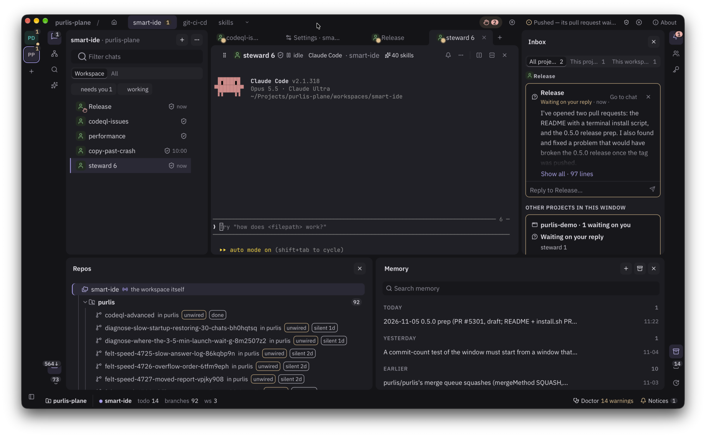

# purlis

**Run many coding-agent chats in parallel, across workspaces and repos, and always know which
one needs you.**

[](https://github.com/purlis/purlis/actions/workflows/ci.yml)
[](https://github.com/purlis/purlis/releases/latest)
[](LICENSE)



purlis is a desktop app for people who work with coding agents all day. Claude Code, Codex and
opencode chats run side by side, each in its own tab, each in the workspace and repo it works
on. The window tells you which chat is waiting for you, so you stop checking terminals.

Everything purlis knows is in a git repository you own: your workspaces, the roles your agents
play, and what earlier chats learned. A new chat starts already knowing what the last one
learned. purlis is a Tauri app with a Rust core and a React window.

## Why purlis

- **Many agents, one window.** Chats on different harnesses and repos run at once. Each one
  reports its state through its hooks and its exit, never through purlis reading its output, so
  "needs you" means it actually needs you.
- **Memory that carries over.** Each workspace keeps a journal, its todos and its memory. Every
  chat writes a session record when it closes, and the next chat starts with what the earlier
  ones recorded.
- **Plain files in git.** Workspaces, personas, memory and settings are files in a repo. Share
  them with a team by pushing, review them in a pull request, and read them without purlis.
- **Sandboxed by default.** Each chat runs in a sandbox purlis builds for its harness. The
  default is a floor every chat gets; the full sandbox limits a chat to the folders and network
  hosts it was given. Your level is yours, kept on your machine
  ([ADR 0067](docs/adr/0067-a-chat-runs-in-a-sandbox-charter-compiles-for-its-harness.md),
  [ADR 0096](docs/adr/0096-your-sandbox-level-is-yours-and-is-kept-on-this-machine.md)).
- **No secrets in the chat.** Credentials live in a vault, in your system keyring or in
  1Password. A chat uses one by name and never sees its value
  ([`secrets.md`](crates/purlis-core/docs/secrets.md)).
- **Your own logins.** purlis uses GitHub's `gh` and GitLab's `glab` as you, and each harness
  with its own sign-in. It holds no forge token and installs nothing into your harness
  ([`forges.md`](crates/purlis-core/docs/forges.md),
  [`harnesses.md`](crates/purlis-core/docs/harnesses.md)).

## Install

purlis runs on macOS (Apple silicon) and Linux (x86_64). There is no Windows build yet.

### Quick install

```sh
curl -fsSL https://raw.githubusercontent.com/purlis/purlis/main/install.sh | sh
```

[`install.sh`](install.sh) is short: read it before you run it. It downloads the latest stable
release from GitHub and installs it:

- **macOS:** `purlis.app` goes into `/Applications`, or `~/Applications` when you cannot write
  to `/Applications`.
- **Linux:** the `.deb`, through `sudo apt install`, which also puts `purlis` on your `PATH`.
  Without apt, the AppImage goes into `~/Applications`.

When the [GitHub CLI](https://cli.github.com/) is installed and signed in, the script first
checks that the download was built by this repository's release workflow, and installs nothing
if it was not. To install the dev build of `main` instead, run
`curl -fsSL https://raw.githubusercontent.com/purlis/purlis/main/install.sh | PURLIS_CHANNEL=dev sh`.

### Install by hand

Download a build from the [releases page](https://github.com/purlis/purlis/releases/latest).

**macOS:** open `purlis-macos-arm64.dmg` and drag **purlis** to Applications. macOS builds are
signed ad hoc and are not notarized, because purlis has no Apple Developer ID yet. macOS
refuses to open an app downloaded in a browser until you clear its download flag, sometimes
calling it "damaged". Run this once, before the first launch:

```sh
xattr -dr com.apple.quarantine /Applications/purlis.app
```

The quick install above doesn't need this step, because a file `curl` downloads carries no
such flag.

**Linux:** install the `.deb` with `sudo apt install ./purlis-linux-x86_64.deb`, or make
`purlis-linux-x86_64-appimage.AppImage` executable and run it.

### After installing

purlis updates itself. It checks each update's signature before installing it, and asks first
([`docs/updating.md`](docs/updating.md)). `purlis update --channel dev` moves a machine to the
dev channel, and `--channel stable` moves it back. To use `purlis` in a terminal on macOS, run
**Install `purlis` command in PATH** from the command palette. To check that a download is a
real purlis build, see [SECURITY.md](SECURITY.md).

On macOS, an ad-hoc signed build counts as a new app after each update, so the Keychain asks
again for the items purlis keeps there. *Always Allow* lasts until the next update
([why](docs/updating.md#macos-privacy-questions-and-why-purlis-needs-no-full-disk-access)).

## Get started

You need at least one harness (Claude Code, Codex or opencode) and your forge's command-line
tool, signed in. If no harness is installed, purlis offers each one's official installer.

1. Open purlis and choose **Create a project**, or open a repo you already have.
2. Make a workspace for the piece of work you are doing.
3. Start a chat in it. Start more as you need them.

The step-by-step guides start from a clean machine:
[Getting started with GitHub](docs/getting-started/github.md) and
[Getting started with GitLab](docs/getting-started/gitlab.md).

## Concepts

[`CONTEXT.md`](CONTEXT.md) is the full glossary. These five cover most of it:

| Word | What it is |
| --- | --- |
| **Project** | The git repo that holds your workspaces, personas, memory and settings. A code repo is never a project: purlis calls it a **repo**. |
| **Workspace** | A named piece of work in a project, with its own `workspace.md`, memory, todos and clones of the repos it works on. |
| **Chat** | One conversation with a coding agent, in a tab, in a workspace or at the project root. |
| **Persona** | A role a chat runs as, with its own `persona.md`, memory and vault. Work for another persona goes to its own chat, by dispatch. |
| **Memory** | What the next chat starts with: a workspace's journal, a persona's memory, shared memory, and the session records chats write when they close. |

## Status

purlis has not reached 1.0 and is still in testing. Until 1.0, a command or a file format can
still change. purlis was called charter until 2026-10, and until 1.0 it still reads charter's
names and answers to the `charter` command
([ADR 0091](docs/adr/0091-the-product-is-purlis-and-reads-its-old-names-until-1-0.md)). What
each release brought is in [CHANGELOG.md](CHANGELOG.md), and `purlis news` prints it.

Builds are published on two channels: **stable**, from release tags, and **dev**, from every
green `main`.

## Supported platforms

What purlis is held to, the CI label each platform is covered on, and what that job proves.
Rows marked evidence are reported and never gate a merge or a release.
[`docs/platforms.md`](docs/platforms.md) is the same table with what it does not promise: no
Intel macOS build, no `.rpm`, and no Windows until the port lands.

| Platform | Floor | CI label | What CI proves |
|---|---|---|---|
| macOS 27 | Apple silicon | `xcode-27` | Evidence: builds the app, compiled from scratch on that image. The image is a preview |
| macOS 26 | Apple silicon | `macos-latest` | Builds the app, and starts and drives it through every scenario test. Evidence: runs the core and app tests, failing when one leaves a process running. Release builds are made on this label (`release.yml`) |
| Ubuntu 26.04 LTS | x86_64 | `ubuntu-26.04` | Evidence: builds the app from scratch on that image and holds its cold start to the 2 s limit |
| Ubuntu 24.04 LTS | x86_64 | `ubuntu-24.04` | Every Rust and web test, the app build, the cold start, and every scenario test. Release builds are made on this label (`release.yml`) |
| Fedora 44 (the current release) | x86_64 | `fedora:44` | Evidence: builds the app against Fedora's own libraries, runs the core and CLI tests as a normal user, failing when one leaves a process running, and starts the app |
| Windows 11 | not supported yet | `windows-latest` | Nothing yet. The job is evidence for the port and allowed to fail. Windows 11 joins this list when the Windows port lands |
| iOS 16.4 or later | no iOS app yet | — | Nothing. The floor any iOS client will be held to |
| Desktop browsers, the current Chrome, Edge, Firefox and Safari | no browser client yet | — | Nothing. The floor any browser client will be held to |

## Documentation

| To | Read |
| --- | --- |
| Install and set up a first project | [Getting started with GitHub](docs/getting-started/github.md), [with GitLab](docs/getting-started/gitlab.md) |
| Learn the words purlis uses | [`CONTEXT.md`](CONTEXT.md) |
| See what purlis is held to | [The spec](docs/spec.md), with its limits and milestones |
| Find why something is the way it is | [Decision records](docs/adr/), from ADR 0025 |
| Read or write a project's files | [The project format](docs/plane-format.md) |
| Understand updates and signatures | [Updating](docs/updating.md) |
| Remove purlis from a machine | [Uninstall](docs/uninstall.md) |
| Build, test or change purlis | [Developing purlis](docs/development.md) |

## Contributing

Bug reports, fixes, tests and documentation are welcome. Read
[CONTRIBUTING.md](CONTRIBUTING.md) first: it covers the build, the checks CI runs, changelog
fragments and decision records. Every commit is signed off under the
[DCO](https://developercertificate.org/) (`git commit -s`). For a larger change, open an issue
before you write code.

The quickest way in:

```sh
git clone https://github.com/purlis/purlis && cd purlis/app
npm install
npm run tauri dev
```

You need stable Rust and Node 24; [Developing purlis](docs/development.md) lists the rest.

## Community and support

- **Questions and ideas:** [Discussions](https://github.com/purlis/purlis/discussions).
- **Bugs and feature requests:** [issues](https://github.com/purlis/purlis/issues/new/choose).
- **Where to go for what, and how soon we aim to answer:** [SUPPORT.md](SUPPORT.md).
- **How we treat each other:** the [Code of Conduct](CODE_OF_CONDUCT.md).
- **Security vulnerabilities:** report them privately, as [SECURITY.md](SECURITY.md) describes,
  never in a public issue.

## Licence

purlis is licensed under the [Apache License, Version 2.0](LICENSE). Copyright 2026 Purlis.
The [NOTICE](NOTICE) file holds the attribution notices that travel with every copy, and the
app shows both under About › Licences.

"Purlis" and the Purlis logo are trademarks of Purlis. The licence does not grant permission to
use them, except as required for reasonable and customary use in describing the origin of the
work; [NOTICE](NOTICE) says so.
