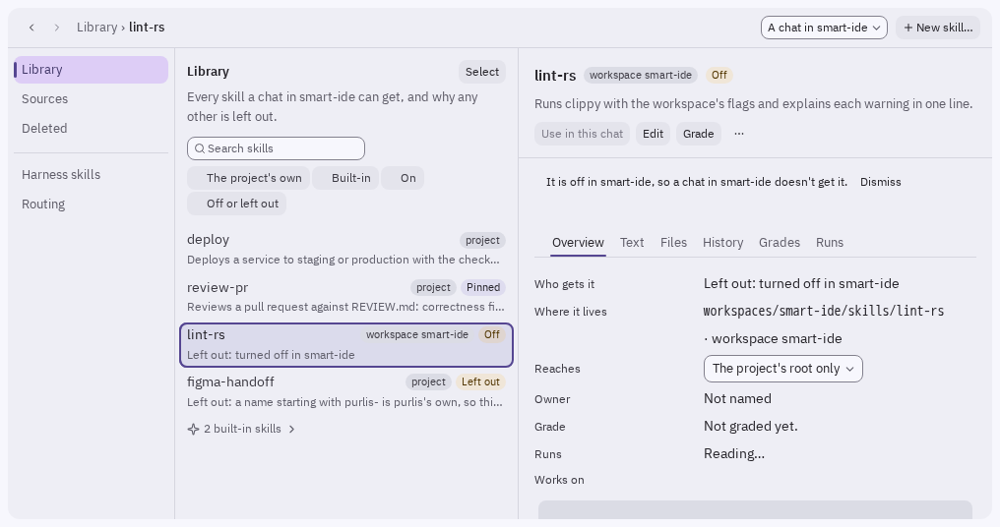
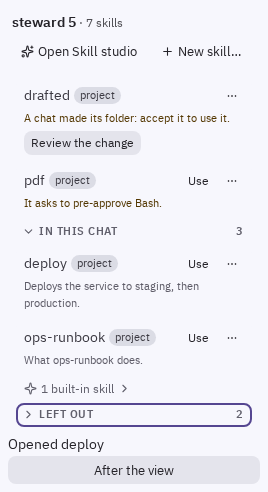
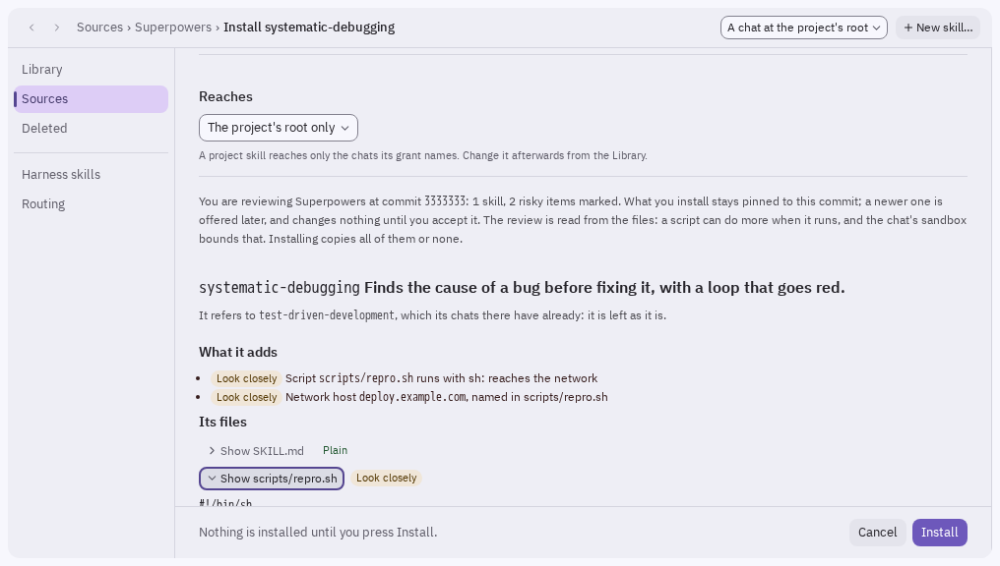
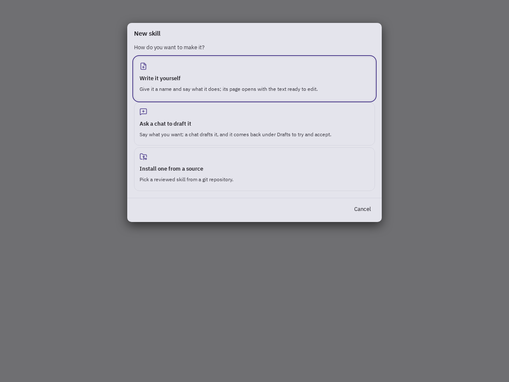
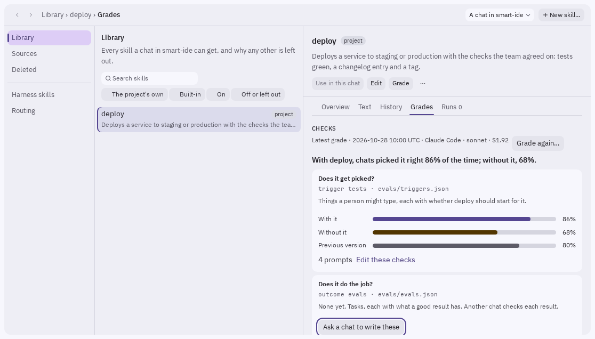
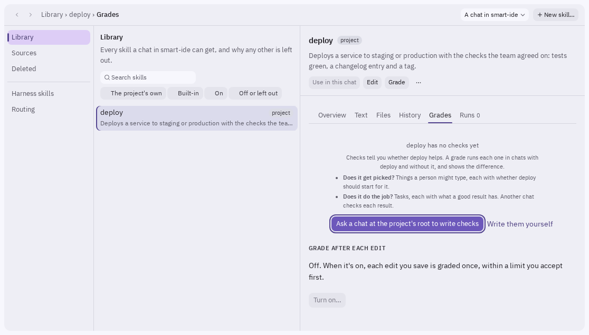
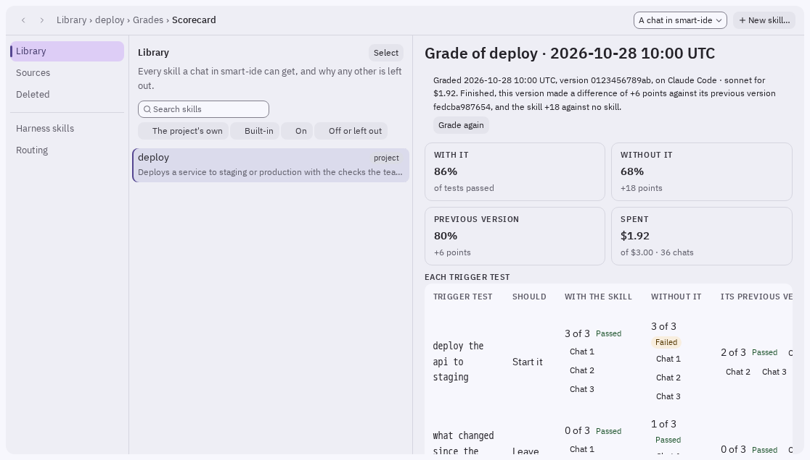
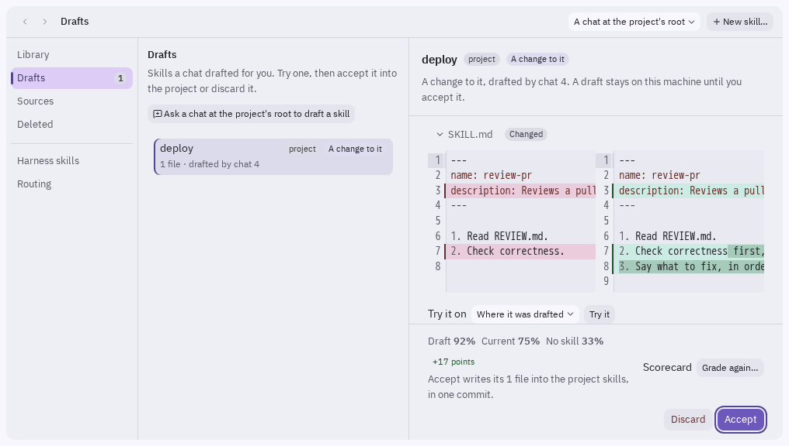
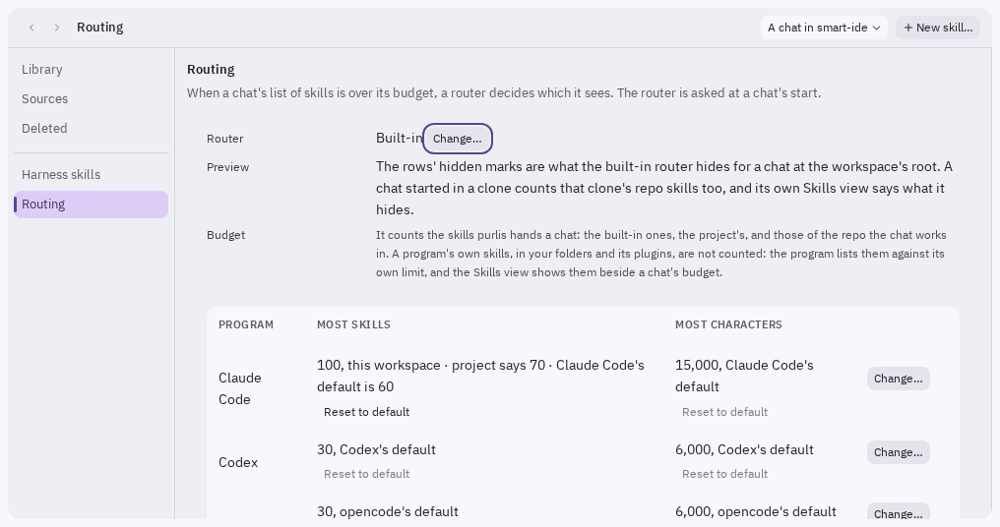
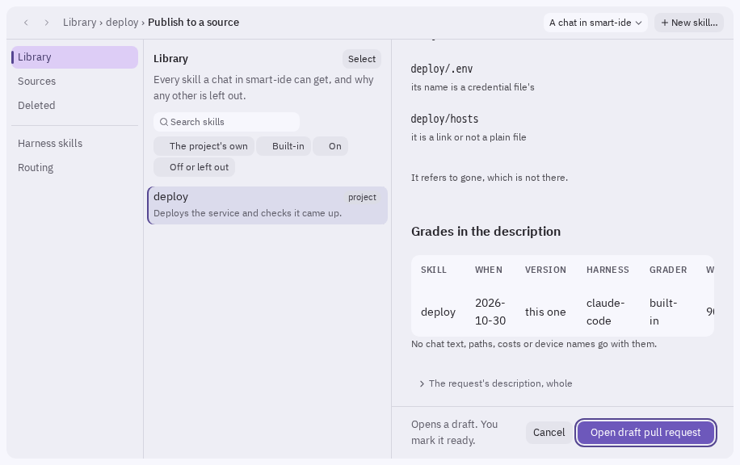

# The Skill studio

A **skill** is a short set of instructions a chat follows when it does a certain kind of job,
such as reviewing a pull request against your team's checklist or deploying a service the way
your team does it. The **Skill studio** is where you see every skill your chats get, and make,
install, change, grade and share them.

This page is for people who use purlis and want their chats to work their way. You don't need
to know how any chat program reads its skills: purlis hands each chat its skills itself.

## What a skill is

A skill is a folder with a `SKILL.md` file in it. The file starts with the skill's **name** and a
one-line **description** of what it does and when to use it, then the instructions themselves.
A skill can also carry scripts, reference files and other files beside `SKILL.md`. This is the
open SKILL.md format, so the same skill works in Claude Code, Codex and opencode.

A chat reads the names and descriptions of all its skills when it starts. When a request fits a
skill's description, the chat picks that skill and follows it. You can also ask for one by name
with **Use skill…** (see [Using a skill in a chat](#using-a-skill-in-a-chat)).

### Where a skill lives decides who gets it

Every skill lives at a **level**. The studio shows the level as a small tag on each row, says it
under **Where it lives** on a skill's page, and asks for it as **Lands in** wherever a skill is
made, copied or installed.

| Level | Where its folder is | Which chats get it |
|---|---|---|
| **built-in** | inside purlis | every chat. You can't edit or turn one off. |
| **project** | `skills/<name>/` at the project's root | chats at the project's root, and the workspaces its grant names (below) |
| **workspace** | `workspaces/<workspace>/skills/<name>/` | that workspace's chats |
| **persona** | `personas/<persona>/skills/<name>/` | that persona's chats, in any workspace |
| **repo** | inside a repo a workspace clones | chats in that repo. purlis lists it and never edits it. |
| **installed** | your own folders for Claude Code, Codex or opencode, or their plugins | chats on that program. purlis lists it and never edits it. |

Each of the project, workspace and persona levels can also be **local**: kept on this machine
and never committed, so your team doesn't get it (the tag reads *local project*, *local
workspace* or *local persona*). **Share** on its page moves it to the shared level, and the next
save commits it.

### A project skill reaches a workspace only once you say so

A project skill's **grant** says where it reaches. The studio calls it **Reaches**:

- **The project's root only**, the default. Nothing is shared until you share it.
- **Every workspace**.
- **The root and** the workspaces you name.

A workspace can turn off a project skill it was granted, and can never turn on one it wasn't.

### When two skills have the same name

A chat gets one copy of a name. The narrower level wins: persona over workspace over project,
and a local copy over a shared one. The copy left out says which copy hid it.

A **built-in skill's** name is never taken. Every built-in skill is named `purlis-<name>`, and no
other skill may start its name with `purlis-` (see [Built-in skills](#built-in-skills)).

A repo's or a program's own skill with the same name as yours is the program's to settle,
since it reads that skill whatever purlis says. Both load, and the studio marks the clash.

## The Library and the Skills view

Open the studio from the palette with **Open Skill studio**, or from the Skills view's header.



**Whose chats**, at the top right, picks whose skills you're looking at: *A chat at the project's
root*, *A chat in* a workspace, or *A chat as* a persona. Everything in the studio answers for
those chats.

The pages on the left are:

- **Library**: every skill those chats can get, and why any other is left out.
- **Needs you**: skills waiting on you, such as a change to review. It only shows when there is
  something in it.
- **Drafts**: skills a chat drafted for you. It only shows when there is one.
- **Sources**: where you install skills from.
- **Deleted**: skills deleted in the last 30 days, which you can bring back.
- **Harness skills**: the skills Claude Code, Codex and opencode bring themselves.
- **Routing**: what a chat sees when it has more skills than fit.

### A row in the Library

Each row has the skill's name, its level tag, at most one mark (**Off**, **Left out**, **Hidden
by the router** or **Pinned**) and one line: what the skill does, or why it's left out. A skill
installed from a source shows the source's label after its name, such as
`grilling · mattpocock`.

**Search skills** finds a skill by what you type. The chips under it, **The project's own**,
**Built-in**, **On** and **Off or left out**, narrow the list. The built-in skills fold into one
quiet line, such as *13 built-in skills*, unless one of them needs your attention.

Pick a row to open the skill's page, with its tabs **Overview**, **Text**, **Files**,
**History**, **Grades** and **Runs**. **Overview** says who gets it, **Where it lives** (its level and
folder), **Reaches** (a project skill's grant) and whether it's pinned.

**Files** shows the skill's whole folder, its `SKILL.md`, `references/`, `evals/`, `scripts/` and
the rest, as a file tree beside a preview of the file you pick. On the project's own skills,
**Edit** beside `SKILL.md` opens it in the Text tab's editor, and **Open in a tab of its own**
opens any file in the project's file tab. A built-in or third-party skill's files are shown read
only. **⋯ → Open in Finder** (Files or File Explorer elsewhere) opens the skill's folder.

### Why a skill is left out

purlis never leaves a skill out without a sentence. A row marked **Left out** says why, for
example:

- it isn't a whole skill (and what its `SKILL.md` is missing);
- it isn't granted to this workspace, or this workspace turned it off;
- a narrower copy with the same name hides it;
- its name starts with `purlis-`, which belongs to purlis's own skills;
- it's archived;
- the chat's program can't use it, or it's missing on this machine.

A skill **hidden by the router** is not left out: the chat can still load it. See
[When a chat has too many skills](#when-a-chat-has-too-many-skills).

### The Skills view: what the chat in front has

The **Skills** view in the left sidebar lists the same skills for the chat in front of you.



- **Needs you** comes first: a change to review, or a skill with a problem to fix.
- **In this chat** is what that chat has right now. A plugin's skills are listed here only while
  that chat really loaded the plugin.
- **Left out** is folded at first. Each skill in it says why. A plugin the chat didn't load folds
  to one line, with **Copy command** where a command would put it right.

While the Skill studio or another tab that isn't a chat is in front, the view keeps answering for
the chat you were last in, until that chat ends. With no chat to answer for, it answers
for a new chat, and the heading reads **A new chat gets** instead of *In this chat*.

A chat keeps the skills it started with. When a skill changes, purlis offers to restart the chat
on the same conversation, so it picks the change up.

## Using a skill in a chat

**Use skill…** lists exactly the skills of one chat, and types the one you pick into that chat,
in the way its program expects, for you to send. It is among the chat's actions: its pane's
**⋯**, the **⋯** or right-click on its row in the sidebar, and the palette, as *Use skill in
<chat>…*. ⌘⇧S (Ctrl+Shift+S off a Mac) opens it for the chat you're in. **Use in this chat**, on
a card's menu in the Skills view and on a skill's page, does the same for that one skill. A
skill that takes arguments asks for them first.

A **manual-only** skill is one a chat never picks by itself: it runs only when you ask for it,
and it costs nothing in the chat's skill budget.

## Installing a skill from a source

A **source** is a git repository of skills. Installing copies a skill into your project, pinned
to the exact commit you reviewed. It never updates by itself.

1. Open **Sources**. The first time, it offers a few well-known collections to start from
   (Anthropic's skills, OpenAI's curated skills and Superpowers), each with why it's there.
   **Add…** fills in **Add a source** for you to confirm. To add any other, press **Add source**
   and type its **Repository**: an `https://` address, or a folder on this machine. **Who can
   browse it** is *The whole project* or *Only this machine*. A private source signs in with a
   vault entry, under *More: branch, folder, sign-in*.
2. Open the source and pick a skill: **Review install**, or **Install all** to tick several.
3. Read the review, headed **Install** *<skill>* **from** *<source>* (or **Install** *N skills*
   **from** *<source>*), then press **Install**.



### What the review shows

Nothing is installed until you press **Install**. The review (the install review, as this page
and the changelog call it) shows:

- **Lands in**: the level the skill is copied into.
- **Reaches**: for a project skill, its grant. It starts at *The project's root only*.
- **What it adds**: the scripts it carries and what runs them, the network hosts its files name,
  any `!` command lines, which some programs run before the chat even reads the skill, and
  anything it would write outside the workspace. Risky items are marked **Look closely**. A skill
  that is only instructions says so.
- **Grade**: where the source carries one, the grade its publisher published with the skill,
  in a file beside its folder. The review says whose it is and that purlis hasn't checked it,
  before any figure, then whether it was measured on the version you are installing or an
  earlier one. A grade file purlis can't read is left out, and the review says why. It is never
  added to your own grades: grade the skill here to measure it yourself.
- **Its files**, each one a click away. Hidden characters are marked, and a file that isn't text
  is said rather than shown.
- **Comes along**: skills this skill refers to, which are installed with it, each with its own
  summary.

The review is worked out from the files, so it shows what they name, not what a script might do
when it runs. What keeps an installed skill in bounds is that it runs in the chat's sandbox, and
that a skill can only narrow what a chat may do, never widen it.

The install is one commit. Later, when the source has a newer commit, the studio says so, and
**Review update** shows what changed, the new things it adds first. Chats keep the current
version until you press **Accept update**.

### When a name is taken

If the level the skill lands in already has a skill with that name, from any source or made
there, the review stops at **This name is taken**. Choose one:

- **Skip it**, or
- **Install it under a new name**. The new name is filled in as `<source>-<name>`, such as
  `mattpocock-grilling`, and you can change it.

A new name changes only the skill's name line and its folder. Its text stays as the source wrote
it. purlis remembers the name it had at the source, so updates still find it. A copy with the
same name at a *different* level doesn't stop the install: the narrower copy wins, as always,
and the review says so in one line.

## Writing and changing a skill

**New skill…**, at the top of the studio and in the Skills view, asks how you want to make it:



- **Write it yourself**: give it a name and say what it does and when a chat should use it, pick
  where it **Lands in** and what to **Start from** (*Blank* or *Steps to follow*). Its page opens
  with the text ready to edit.
- **Ask a chat to draft it**: say what you want. A chat writes it, and it comes back under
  **Drafts**.
- **Install one from a source**: see above.

A good description says both what the skill does and when to use it. The chat decides whether to
pick a skill from its description alone.

### Drafts and Try it

A draft is a new skill, or a change to one, waiting for you. On **Drafts**, **Try it** opens a
scratch chat that has the draft and purlis's own skills and nothing else, in a throwaway folder.
**Accept** writes it into the project in one commit. **Discard** deletes the draft and leaves the
project as it was.

### Editing

**Edit**, on a skill's page, turns its **Text** tab into an editor. As you type, a check tells
you whether it's still a whole skill and what is worth knowing, such as a description too short
to say when to use the skill, or a skill it names that doesn't exist. **Save** makes a new
version. Chats started after it get it.

From the **⋯** menu you can **Rename…** (purlis changes every persona and skill that names it),
**Move to another level…**, **Deprecate…** (it still works, points to its replacement and is
listed last), **Archive…** (it never loads until you unarchive it), **Improve from runs…** (a
chat reads the skill's runs and grades and drafts an edit, which you can grade before you accept
it: see [Grading a draft](#grading-a-draft)), and **Delete…**. A deleted
skill waits under **Deleted** for 30 days. **History** lists every saved version, with **Revert
to this**.

### Shipping an artifact with a skill

A skill can bring a page for the workspace's activity bar: an **artifact template**. Put it in
the skill's own folder as `artifacts/<name>/`, with its `index.html` and anything the page loads
beside it:

```text
backlog-sync/
  SKILL.md
  artifacts/
    backlog-state/
      index.html
      style.css
```

The skill's steps end by asking purlis for it, before writing its data:

```bash
purlis artifact pin backlog-state --skill backlog-sync --command "<what writes its data>"
```

In a chat, purlis copies the page into the workspace's `artifacts/backlog-state/` and shows you
a proposed pin; only your **Pin** in Pin to workspace pins it. At your terminal it copies and
pins at once. Either way:

- **Data files are never copied.** `data.json` and `data/` are each person's own: the skill
  writes them into the workspace's copy as it runs, and `--command` is what Regenerate runs to
  write them again.
- **A page that would not be pinned is not copied.** The page is read within the size cap and
  checked for anything shaped like a secret first, and the skill is found by its name among the
  chat's own skills, never by a path.
- **A run again leaves the copy as it is**, when it holds the same page, data included. A folder
  holding another page is never written over: to take a skill's newer page, unpin the artifact,
  remove its folder, and run the skill again.
- **Script asks each person.** A page with script runs only once you approve it in its bar, as
  any artifact's does.

Before you ship it, `purlis artifact check <folder>` checks the page's declaration and the
queries it calls, and `purlis artifact types` and `purlis artifact mock` let you build it in any
browser.

## Grading a skill

A grade answers two plain questions about a skill, by running real chats. The skill's **Grades**
tab calls the tests for them its **Checks**, a card for each question:

- **Does it get picked?** Things a person might type, each with whether the skill should start
  for it, including near misses it should leave alone. Their small label says what they are in
  the skill's files: *trigger tests*, in `evals/triggers.json`.
- **Does it do the job?** Tasks, each with what a good result has. Another chat, the judge,
  checks each result. Their label says *outcome evals*, in `evals/evals.json`.

Each check runs several times **with the skill**, **without it** and, where the skill had an
earlier version, **with its previous version**, so you can see the difference the skill makes.



Once the skill has been graded, one sentence under **Checks** says how it did, such as *With
deploy, chats picked it right 86% of the time; without it, 68%.* Each card then shows its own bars
for **With it**, **Without it** and **Previous version**, how many checks it has, and **Edit
these checks**, which opens their file.

### Writing checks



A skill with no checks yet says what each kind is and offers:

- **Ask a chat to write checks**: a chat opens with the request typed, for you to send. It writes
  both kinds, and they come back as one draft that waits on the **Grades** tab. **Accept checks**
  keeps both kinds together, and **Discard** drops them.
- **Write them yourself**: starts `evals/triggers.json` from a short template and opens it.

A card with none of its kind yet has **Ask a chat to write these**, for that kind alone.

### Before a grade: the plan

**Grade**, at the top of the skill's page, or **Grade <name>…** on its **Grades** tab, opens
the plan. Nothing runs until you press **Start grading**. The plan shows:

- **What it runs**: every check, as the chat will read it.
- **Where it runs**: the profile and model the chats use. The chats are paid for by that
  profile's account, as any chat is.
- **What it may spend**: how many chats, at most, and the **Token cap**, 200,000 tokens unless
  you set another on this machine. A grade stops once its chats reach the cap.

The chats run in purlis's full sandbox, with nothing of your own allowed in, and are never shown
as tabs. A chat that would ask you something is ended there instead. **Stop** keeps what ran so
far.

### After a grade: the grade and the scorecard



The **scorecard** shows the share of checks passed **With it**, **Without it** and against the
**Previous version**, with the difference in points under each, and what the grade spent. Below
are each check's results, and each check's chats, which you can open.

Under the checks, **Grades** lists every grade, newest first, with the version it graded. Grades
are saved with the project, so your team sees them too.

### Grading after each edit

**Grade after each edit**, at the foot of the **Grades** tab, is off for every skill. Its **Turn
on…** opens a plan that says what each edit you save will run and may spend. Nothing changes until
you press **Turn on grading after each edit** there. Then each edit you save in the studio's
editor is graded once, within the limit you accepted. A grade that would run more or cost more
waits and asks you again, with **Read the new plan…**. **Turn off** stops it. Edits made from a
terminal or by a chat are never graded.

### Grading a draft



A draft can be graded before you accept it. On its page under **Drafts**, **Grade against the
current version…** grades what **Accept** would write against the skill as it is now. A new skill
has no current version, so its button reads **Grade…** and grades it against no skill alone. The
grade uses the draft's own checks, and opens the same plan as any grade.

The result stands beside **Accept**: the **Draft**, **Current** and **No skill** scores and the
difference in points, with **Scorecard** and **Grade again…**. A grade never stops you accepting
or discarding the draft. It is kept on this machine, out of the skill's **Grades** list, and if
the draft changes after it, it is marked **Out of date**. A draft that changes only the skill's
checks has nothing to grade against the current version, and says so.

## When a chat has too many skills

Every chat program has room for only so many skills in a chat's list before it starts dropping
descriptions. purlis keeps each chat under that line with a **skill budget**: how many skills,
and how many characters of their descriptions, one chat's list may hold. The studio's **Routing**
page shows each program's budget. By default it is 60 skills and 15,000 characters on Claude
Code, and 30 skills and 8,000 characters on Codex and opencode.



A chat's **Skills** chip, on its pane, shows how many skills it has, and warns near the budget.

### Changing the budget

Each program has its own budget: **Most skills in a chat's list** and **Most characters in a
chat's list**. Change it where you see it: on the studio's **Routing** page each program has a row
with **Change…**, and the numbers in the Skills view take you there, as does `of 60` beside the
skills warning on a chat's pane. **Settings** shows the same rows, under the project's or a workspace's **Skills**
group, in **In force**.

- **Whose it is.** In a workspace, the number is that workspace's. At the project's root it is the
  project's, for every workspace that sets none. Under a persona it is the project's too: a persona
  has no budget of its own, and neither do you.
- **As you type**, **Change…** says which skills new chats would list or hide, about how many more
  or fewer tokens that is per chat, and whether it passes what the program can hold. More
  characters cost more of each chat's context, about 91 tokens a skill.
- **Where each number comes from.** A row says it: "100, this workspace · project says 60 · Claude
  Code's default is 60". **Reset to default** beside a number takes out what this level says. In a
  workspace, the project's number then stands, if it has one.
- **What it takes.** A whole number of at least 1, or empty for the number below it. There is no
  maximum. A number past what a program can hold is never refused: Change… says what Codex would
  drop. Below your pinned skills it says they are still listed and go over it.
- **When it applies.** New chats get it. Open chats keep what they started with, and offer a restart
  once if the change moves what they would list.

### Making room

When these chats are over their budget, the **Budget** line on **Routing** says how many skills
the router hides from their lists and offers **Make room…**. The **Install all…** review offers it
too when what you install would take a chat's list past a program's budget, and says which.

**Make room…** opens the Library in **Select** with the skills least used in the last 30 days
first, each row saying its runs ("No runs in the last 30 days", "4 runs in the last 30 days"),
counted from the chats' run records. Nothing is ticked: you choose. It offers only **Turn off**
and **Archive** for what goes, and **Pin** for what stays listed. Each is one change with one Undo,
as Select's actions are, and Select ends after it.

### Routers, the index skill and pins

When a chat's skills are over its budget, a **router** decides what the chat's list shows. The
**built-in router** shows every skill while they fit. Past the budget, it lists your pinned
skills, purlis's own, and one **index skill**, `purlis-skill-index`, which names every other
skill in a line. Nothing is out of reach: the chat loads a hidden skill by name when a request
needs it, and **Use skill…** still starts it for you.

- **Pin** a skill to keep it listed past any budget: the **Pinned** switch on its page, for the
  workspace's or the persona's chats picked in **Whose chats**, or **Pin to this workspace** on
  its card in the Skills view. A skill's page lists who pins it.
- **Choose a router** for a workspace or a persona on **Routing**, with **Change…**. Other
  routers come as extensions. A router that reads your prompts reads only once you turn on **Let
  it read prompts**.
- **Grade the router…** runs your library's trigger tests with the router in place, against the
  built-in router.

## Publishing and exporting a skill

From a skill's **⋯** menu:

- **Publish to a source…** proposes the skill to a source on GitHub or GitLab, as a draft pull
  or merge request from a new branch. You mark it ready. The review shows every file that goes,
  the skills it brings along, and its grades as a summary in the request's description. The
  grades also go in a file beside the skill's folder, `<skill>.grades.json`, which an install
  review reads as your grades. No chat text, paths, costs or device names go with them.
- **Export…** saves the skill as **A zip** or **A folder**, to send to someone or drop into
  another project.

Some things stop a publish, with no way past them: anything that looks like a credential, a
skill kept on this machine (move it to a shared level first), personal data or a path into your
home folder. An export stops only for a credential, since it stays with you until you share it.
Only you can publish: a chat never can.



## Built-in skills

purlis ships its own skills, the same for every chat program, and each is named
`purlis-<name>`: `purlis-handoff`, `purlis-smart-close`, `purlis-secrets` and so on. You can't
edit or turn one off. To change one, **Make my own copy…** makes a skill of your own under a new
name, which chats get beside the built-in one.

One of them, `purlis-skill-studio`, holds the steps a chat follows when the studio asks it for
something: **Ask a chat to draft a skill**, **Ask a chat to write checks** (or one kind of them),
**Improve from runs…** and **Ask the chat to redo it**. The studio types a one-line prompt that names
`purlis-skill-studio`, the job and the skill's folder, and the skill says how to write each file and
that what the chat writes comes back to you as a draft. It never runs a grade itself.

**Old names in your files keep working.** A persona's `skills:` list, a skill's text or a
curation action that names `purlis:handoff` or `charter:handoff` means `purlis-handoff`.

**A command you type needs the new name.** In Claude Code, `/purlis:handoff` now answers that it
doesn't know the command. Type `/purlis:purlis-handoff`. A bare `handoff` means a skill of your
own with that name, never purlis's.

## For extension authors: Capabilities v1

An extension can add to the Skill studio by declaring a capability in its manifest. Three are
**version 1** of the public extension API, and won't change shape without a new protocol:

- **`grader`**: grades a skill's trigger tests. purlis runs every chat it asks for.
- **`studio-panel`**: adds a panel to a skill's page.
- **`skill-router`**: decides which skills a chat's list hides, and, if it reads prompts, which
  skills suit a prompt.

Three more, **`skill-source`**, **`skill-lint`** and **`skill-template`**, work but are still
experimental, and the approval prompt says so. An extension that declares any of them runs
confined, in the same sandbox a chat runs in, and never reaches a model itself.

The messages, the manifest and how version 1 may change are in
[the extension API](extension-api.md).

## From a terminal

`purlis skill` does most of this from a terminal: `list` and `show`, `new`, `edit`, `mv`, `rm`
and `restore`, `share`, `grant`, `pin`, `install` and `update`, `grade`, `runs`, `history` and
`revert`, `publish` and `export`. `purlis skill --help` says each one's options.
